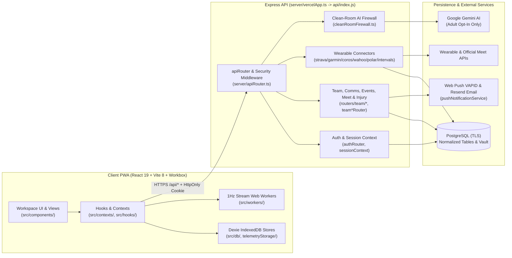

# MeetReady System Architecture

MeetReady is a local-first athletic readiness PWA paired with an Express API (`server/vercelApp.ts` → `api/index.js`) backed by encrypted PostgreSQL persistence (`server/tokenVault.ts`).

---

## High-Level System Topology

---

## Module Ownership Map

| Directory / File | Responsibility | Notes / Ceilings |
| :--- | :--- | :--- |
| `src/types.ts` + `src/types/*.ts` | Shared frontend & backend TypeScript contracts | `src/types.ts` is a thin barrel (`<= 120` lines); explicit `.ts` extensions required |
| `src/utils/telemetryStorage.ts` + `src/utils/telemetryStorage/*.ts` | Profile calibration, Dexie snapshots, activity dedup/merge, wellness recompute, client storage | Thin barrel (`<= 120` lines); must stay decoupled from lazy heavy modules |
| `src/physiology/` | Pure physiological math (`CTL`/`ATL`/`TSB`, `rTSS`, `CP`/`W'`, `VDOT` pods, durability, 3-layer FAT reconciliation, NCAA conversions) | Pure deterministic TypeScript; shared by client, workers & server |
| `src/db/` | Dexie schemas (`workoutStore.ts`, `teamChatOutbox.ts`) | Offline-first IndexedDB persistence and durable outboxes |
| `src/contexts/` & `src/hooks/` | Workspace state providers and cloud/wearable/team sync hooks | Includes `useAthleteCloudSync.ts` fast-reload protection |
| `src/components/` | UI views, modals, charts (`uPlot`), maps (`Leaflet`), stopwatch, coach cockpit | Every component file `<= 2,500` lines; `App.tsx <= 2,100`; Impeccable audit clean |
| `src/workers/` | Off-main-thread `.FIT`/`.GPX`/`.TCX` decoding and 1Hz rep detection | Keeps stopwatch and scroll threads stutter-free |
| `server/vercelApp.ts` + `server/apiRouter.ts` | Express app construction, security headers, health probe (`/api/health`), router mounting | Imported natively by Node 22 ESM in CI; bundled to `api/index.js` |
| `server/routers/` & `server/routers/team/*.ts` | HTTP route handlers (`auth`, wearables, billing, injury, events, meet-day, `team/*`) | Thin handlers delegating business rules to `server/*Service.ts` |
| `server/*Service.ts` | Domain services, RBAC, Postgres queries, `AES-256-GCM` vault, Clean-Room AI, Web Push/Email | Enforces COPPA `<13`, U18 Guardian-CC, FERPA photo opt-out |
| `tests/` & `e2e/` | Vitest unit/Postgres integration suites + Playwright desktop/mobile E2E matrix | Enforces line caps, bundle budgets, and visual/functional parity |

---

## Key Data Flow & Reliability Invariants

### 1. Local-First IndexedDB ↔ Cloud State Hydration
- On boot, local IndexedDB snapshots (`src/utils/telemetryStorage/snapshotStore.ts`) hydrate UI immediately so offline/trackside startup is instantaneous.
- `useAthleteCloudSync.ts` tracks per-field session edits (`sessionEditedFieldsRef`) independently (`activities`, `wellnessDays`, `plannedEvents`, `gearItems`, `athleteProfile`) so partial boot responses (such as `/api/auth/me` updating `athleteProfile`) never mark `plannedEvents` or `gearItems` dirty or overwrite non-empty cloud state on fast reloads.

### 2. Offline Durable Outboxes
- Practice attendance logs, delegated timing splits, and unified team chat messages (`MeetReadyChatOutboxDB`) queue locally when trackside connectivity drops and flush idempotently on reconnect or app foreground.

### 3. Security, Privacy & Normalized Storage
- Sensitive OAuth credentials live inside `AES-256-GCM` encrypted tenant vaults backed by PostgreSQL (`thresh_tenant_vault`) and normalized relational tables (`thresh_teams`, `thresh_team_members`, `thresh_audit_log`, `thresh_stripe_events`) with `pg_advisory_xact_lock` serialization.
- Strava-derived raw workouts never cross `server/cleanRoomFirewall.ts` to Gemini prompts or peer team views.

---

## Further Reading

- [Design System Spec (`DESIGN.md`)](./DESIGN.md) and [Design Tokens Guide (`docs/DESIGN_SYSTEM.md`)](./docs/DESIGN_SYSTEM.md)
- [Contributor Guide (`CONTRIBUTING.md`)](./CONTRIBUTING.md)
- [REST API & Security Architecture (`docs/API_AND_SECURITY.md`)](./docs/API_AND_SECURITY.md)
- [Feature Specs (`docs/specs/`)](./docs/specs/README.md) and [Architecture Decision Records (`docs/adr/`)](./docs/adr/001-dual-storage-indexeddb-and-postgres-vault.md)
