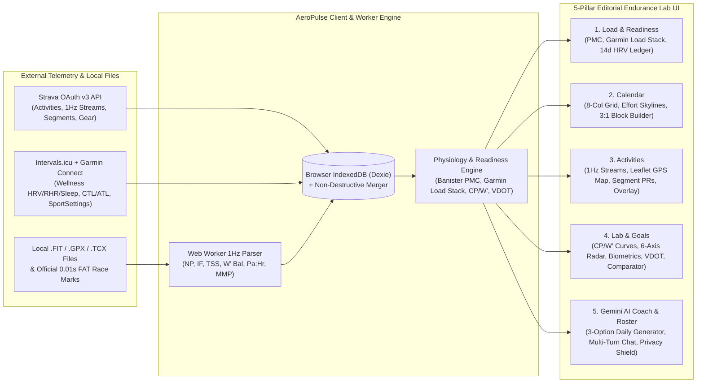

# AeroPulse — Unified Multi-Sport Physiology, Load, Segments & AI Coaching PWA

**AeroPulse** is a full-stack, mobile-ready Progressive Web App (PWA) and desktop physiological performance cockpit built in the **Editorial Endurance Lab** aesthetic. It unifies **Intervals.icu** (including auto-synced **Garmin Connect** daily health & workout telemetry) and **Strava** accounts with local **1Hz `.FIT` / `.GPX` / `.TCX` binary parsing**, **Daily Stacked Garmin Load Focus bars**, **Closed-Loop Readiness Workout Morphing**, and a context-aware **Google Gemini Training & Recovery Coach**.

---

## Documentation Suite

| Guide | Purpose |
| :--- | :--- |
| **[Interactive In-App Guide](src/components/UserGuideModal.tsx)** | Click the **`?` (User Guide)** button in the top navigation bar at any time for an interactive, searchable 7-chapter walkthrough with **"Try It Live →"** deep links. |
| **[User Manual (`docs/USER_GUIDE.md`)](docs/USER_GUIDE.md)** | Step-by-step manual covering all 7 chapters: Onboarding, Strava/Intervals Sync, `.FIT` import, PMC & Garmin Load Focus, Calendar & Block Builder, 1Hz Activity Inspector, Lab Curves, and Coaching Roster. |
| **[Physiology & Math Reference (`docs/PHYSIOLOGY_AND_METRICS.md`)](docs/PHYSIOLOGY_AND_METRICS.md)** | Complete mathematical formulas and exercise physiology reference: Banister `CTL`/`ATL`/`TSB`, Garmin Load Focus zone classification, Coggan `NP`/`IF`/`TSS`, `Pa:Hr` Aerobic Decoupling, Monod-Scherrer `CP`/`W'`, Skiba `W' Balance`, Daniels `VDOT`, and 7-day `HRV CV`. |
| **[Design System (`docs/DESIGN_SYSTEM.md`)](docs/DESIGN_SYSTEM.md)** | Complete reference for the **Editorial Endurance Lab** design system, Tailwind v4 `@theme` tokens, macOS Tahoe `.liquid-glass` surfaces, z-index hierarchy (`z-[15]` to `z-[110]`), and Light/Dark mode contrast rules. |

---

## Why AeroPulse? (AeroPulse vs. Intervals.icu vs. Strava vs. Runna / TrainerRoad)

Endurance athletes typically juggle three disconnected platforms:
1. **Intervals.icu / WKO5** for deep physiological charts (`CTL`, `ATL`, `CP`, `W'`, `Pa:Hr`), which lack automated daily workout morphing when morning HRV or sleep crashes.
2. **Runna / TrainerRoad** for structured workout prescriptions, which often operate in a silo without combining multi-sport outdoor GPS segments, track FAT marks, and real-time autonomic readiness.
3. **Strava** for GPS route maps, segment PR leaderboards, and social kudos, which lacks Banister impulse-response modeling, 1Hz W' balance depletion, and autonomic HRV baselines.

**AeroPulse bridges all three into a single zero-compromise cockpit:**

| Capability | Intervals.icu | Strava | Runna / TrainerRoad | **AeroPulse** |
| :--- | :---: | :---: | :---: | :---: |
| **Banister PMC (`42d CTL`, `7d ATL`, `TSB`, `Ramp Rate`)** | Yes | No | No | **Yes (Interactive ECharts + Future Projection)** |
| **Chronological Multi-Workout Garmin Load Focus Stack** | Partial | No | No | **Yes (`Low Aerobic`, `High Aerobic`, `Anaerobic` per-workout stack)** |
| **Closed-Loop Morning Readiness Workout Morphing** | No | No | Partial | **Yes (Optimal / Modulated -15% / Recovery auto-morphing)** |
| **Separate Outdoor vs. Indoor/Smart-Trainer FTP & Curves** | Yes | No | Partial | **Yes (Global `Combined` / `Outdoor` / `Virtual` modality filter)** |
| **1Hz Stream Inspector (`Watts`, `HR`, `Pace`, `W' Bal`, `Pa:Hr`)** | Yes | Partial | Partial | **Yes (Synchronized crosshair, lap table & 2-workout overlay)** |
| **Strava Segment PR Leaderboard & Leaflet Route Map** | Partial | Yes | No | **Yes (Zone-colored polylines + benchmark climb history)** |
| **Verified 0.01s FAT Track/XC Race Logger & VDOT Predictor** | No | No | Partial | **Yes (Athletic.net / TFRRS / MileSplit / RunSignup + Riegel)** |
| **Coach-Edit Roster + Strava Compliance Privacy Shield** | Yes | No | No | **Yes (Granular per-domain visibility + GPS redaction shield)** |

---

## System Architecture



---

## Key Capabilities

1. **Autonomic Readiness & Performance Management Chart (PMC)**:
   - Correlates daily **HRV (`rMSSD`)** vs. 7-day rolling baseline and 60-day normal corridor, **Resting HR**, **Sleep Duration & Score**, and **VO2max** with chronic training load (**Fitness `CTL`**, **Fatigue `ATL`**, **Form `TSB`**, and weekly **Ramp Rate**).
   - **Daily Stacked Garmin Load Focus Bars**: Every daily bar on the PMC stacks your chronological workouts (`Morning` -> `Afternoon` -> `Evening`) color-coded by **Low Aerobic (`#38bdf8` Cyan)**, **High Aerobic (`#f97316` Orange)**, and **Anaerobic (`#d946ef` Magenta)**.
2. **Closed-Loop Readiness Workout Morphing & 8-Column Training Calendar**:
   - Evaluates morning autonomic state to morph today's scheduled workout between **Optimal Progression**, **Modulated Aerobic (`-15%` load)**, and **Parasympathetic Recovery**.
   - Includes an **Intervals-Syntax Structured Workout Builder** (`- 15m 60% FTP`) with live Effort Zone Skylines (`Z1`–`Z6`) and a **Multi-Week `3:1` Periodized Block Generator** with automatic pre-race taper.
3. **Global Outdoor vs. Indoor (Smart Trainer / Treadmill) Modality Split**:
   - One-click filtering across all running and cycling workouts, power/pace curves, and annual mileage trackers to isolate **Outdoor Only**, **Virtual / Smart Trainer / Treadmill**, or **Combined** telemetry.
4. **4-Workspace Activity Inspector & Strava Segment Performance**:
   - Inspects 1Hz time-series streams (`Watts`, `Heart Rate`, `Pace`, `Cadence`, `Altitude`, `W' Balance`), **Aerobic Decoupling (`Pw:Hr` / `Pa:Hr`)**, 7-zone histograms, interactive **Leaflet GPS Route Maps**, **Strava Segment Efforts** (`PR #1/2/3`, grade, W/kg), and **2-Workout Overlay Comparisons**.
5. **Lab & Goals (`Goals & Totals`, `Power & Pace`, `Biometrics`, `Benchmarks`)**:
   - **Goals & Totals**: Independent Running & Cycling annual distance targets, **Daniels VDOT + Riegel Race Predictor**, Verified **0.01s FAT Track/Road/XC Race Logger**, and Bike/Shoe gear wear alerts.
   - **Power & Pace**: Monod-Scherrer **Critical Power (`CP`) & `W'`** hyperbolic curve solver and **6-Axis Athlete Phenotype Radar**.
   - **Biometrics**: 7-day **HRV Coefficient of Variation (`CV%`)**, Sleep Debt, and **Efficiency Factor (`EF`) vs. Decoupling (`Pa:Hr`)** quadrant scatter.
   - **Benchmarks**: **2-Athlete Side-by-Side Comparator** and custom dual-metric time-series/scatter chart builder.
6. **Coaching Roster, Privacy Shield & Gemini AI Coach**:
   - Connect with coaches (`COACH_EDIT`) or training partners (`FRIEND_VIEW`), enforce the **Strava Compliance Shield** (redacting third-party Strava-only raw GPS while sharing derived fitness), and chat with the context-aware **Google Gemini Coach**.

---

## Forking & Self-Hosting Guide (Bring Your Own API Keys)

Anyone can fork this repository and connect their own **Intervals.icu**, **Garmin Connect**, **Strava**, and **Google Gemini** accounts. You can provide credentials either via **Environment Variables** or directly inside the app's **Data Sources** modal (`Database` icon in the top header).

### Step 1: Link Garmin Connect to Intervals.icu (For Garmin Users)
Because Garmin's enterprise API is closed to personal developer keys, AeroPulse syncs your Garmin workouts and daily wellness metrics (`HRV`, `Resting HR`, `Sleep`, `VO2max`, `Weight`) through **Intervals.icu**:
1. Log into [https://intervals.icu](https://intervals.icu) and open **Settings**.
2. Under the **Garmin** section, check both **Download activities** and **Download wellness data** (`HRV`, `RHR`, `Sleep`, `Weight`, `Stress`).
3. Scroll down to **Developer Settings** and click **View** next to **API Key** to copy your personal `INTERVALS_API_KEY`.
4. Note your **Athlete ID** (or use `0`, which automatically resolves to the owner of the API key).

### Step 2: Create Your Personal Strava API Application
1. Go to [https://www.strava.com/settings/api](https://www.strava.com/settings/api) and create an API application.
2. Note your **Client ID** (`STRAVA_CLIENT_ID`) and **Client Secret** (`STRAVA_CLIENT_SECRET`).
3. Set the **Authorization Callback Domain** to the hostname where your app is hosted:
   - For Vercel: `your-project-name.vercel.app` (do not include `https://` or paths in Strava's domain field)
   - For Local Development: `localhost`

### Step 3: Get a Google Gemini API Key
1. Visit [https://aistudio.google.com/app/apikey](https://aistudio.google.com/app/apikey) and generate a Gemini API key (`GEMINI_API_KEY`).

---

## Local Setup & Environment Variables

```bash
# 1. Install dependencies
npm install

# 2. Copy .env.example to .env and fill in your keys (optional — can also be entered in the UI)
cp .env.example .env

# 3. Start the full-stack Express + Vite development server on port 3000
npm run dev

# 4. Run production typecheck & bundle build
npm run build
```

### Supported `.env` Variables

```env
GEMINI_API_KEY=your_gemini_api_key
INTERVALS_API_KEY=your_intervals_icu_personal_api_key
INTERVALS_ATHLETE_ID=0
STRAVA_CLIENT_ID=your_strava_client_id
STRAVA_CLIENT_SECRET=your_strava_client_secret
```

---

## Installing as a Mobile / Desktop PWA

- **Android / Desktop (Chrome, Edge, Brave)**: Click the **Install App** button in the top navigation bar (or inside the **Data Sources** modal) for one-tap native installation.
- **iOS / iPadOS (Safari)**: Tap **Install on iOS** in the header (or tap the Safari **Share** button and select **Add to Home Screen**) to launch AeroPulse in standalone full-screen mode with offline IndexedDB persistence.
