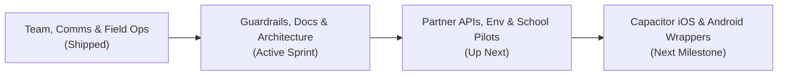

# MeetReady High-Level Product Roadmap

> **Canonical Issue & Sprint Board:** [Linear — MeetReady (`MEE`)](https://linear.app/meetready)  
> This document summarizes strategic quarterly milestones only. Individual tasks, bugs, and WIP assignments live exclusively in Linear (`MEE-XX`).

---

## Quarterly Milestones

| Milestone | Linear Project | Status | Focus |
| :--- | :--- | :--- | :--- |
| **Team & Comms Platform (Phases 1–3)** | `Team & Comms Platform (Phases 1–3)` | **Completed** | Mondo Clay visual system, Launch P0/P1 security/scale, Delegated Timing (`/time`), External Meet Interop, 5-tab simplified Coach Workspace, TeamEvents + `.ics`, Family Hub, Unified Comms + Push-to-Email fallback, Curated Meet Albums + FERPA opt-out. |
| **Engineering Hygiene & Modularization** | `Architecture, Guardrails & Docs Cleanup` | **In Progress** | `AGENTS.md` + workspace skills, `ARCHITECTURE.md` + `CONTRIBUTING.md`, reconciled docs/specs/ADRs, and domain modularization (`types`, `teamRouter`, `telemetryStorage`). |
| **Production Env & Commercial Launch** | `Partner APIs, Env Setup & Commercial Launch` | **Planned** | Vercel prod env (`DATABASE_URL`, Stripe, Redis, VAPID), `procurement@meetready.app` vendor packet (W-9, CA SDPC NDPA), wearable partner approvals, Founding Season outreach. |
| **Native Mobile Wrappers** | `Mobile Wrappers (Capacitor iOS & Android)` | **Backlog** | Capacitor iOS & Android wrappers, APNs/FCM push, universal links (`/join`, `/time`, OAuth), App Store & Play Store rollout. |
